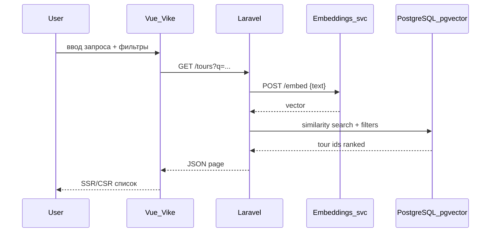

# PRD: Каталог туров (публичная часть + админка)

## TL;DR

Разработать полноценный **каталог туров** с публичной витриной (фильтры, семантический поиск, карточки и детальные страницы) и **админской панелью** для управления турами, датами/ценами и медиа. **Бронирование не реализуем** — пользователь только просматривает и сравнивает предложения.

Стек (обязательный): **монорепозиторий**, backend на **Laravel** (допустимы Symfony / Yii — по согласованию, в репозитории фиксируется один), frontend **Vue 3 + Vike (SSR) + Vite**, **Tailwind CSS 4**, UI‑библиотека с **кастомной темой**, **PostgreSQL** (+ **pgvector** для эмбеддингов), **Docker Compose**, лёгкая модель с **Hugging Face** для расчёта эмбеддингов. Плюс: **автогенерация тура через LLM** в админке.

---

## Цель проекта

- Показать полный вертикальный срез: **SSR‑витрина → REST API → БД → поиск по эмбеддингам → Docker**.
- Реализовать домен «тур» со всеми заявленными полями и вариантами дат/цен.
- Довести продукт до состояния, пригодного для **реальных пользователей** (не только демо): публикация черновиков, SEO, обработка ошибок, валидация, безопасность админки, производительность списков.

## Нецели (явно не делаем)

- Оформление бронирования, оплата, корзина, личный кабинет туриста.
- CRM, отзывы, рейтинги, избранное (можно в backlog).
- Мультиязычность интерфейса (достаточно русского UI; контент туров — на языке, введённом в админке).
- Мобильное нативное приложение.
- Сложная аналитика и A/B‑тесты.

---

## Пользователи / персоны

| Персона | Цель |
|--------|------|
| **Гость (турист)** | Найти тур по интересам, сравнить даты и цены, посмотреть маршрут и фото. |
| **Контент‑менеджер / админ** | Создавать и публиковать туры, загружать фото, задавать маршрут, даты и цены; при необходимости — сгенерировать черновик через LLM. |

Для production‑готовности админка **защищена аутентификацией** (см. F-Admin-Auth). Публичная часть доступна без логина.

---

## Сущность «Тур»

Каждый тур включает:

| Поле | Описание | Правила |
|------|----------|---------|
| **Фотоальбом** | Галерея изображений (обложка + доп. фото) | Мин. 1 фото для публикации; порядок сортировки; alt‑текст; лимит размера файла |
| **Описание** | Краткое (анонс) + полное (HTML/Markdown — выбрать один формат и зафиксировать) | Мин. длина для публикации |
| **Длительность** | Число дней/ночей (например `7 дней / 6 ночей`) | Целое ≥ 1 |
| **Тип (категории)** | Один или несколько тегов/категорий (горы, море, экскурсии…) | Справочник категорий в БД |
| **Маршрут на карте** | Точки маршрута + полилиния на **Яндекс.Картах** | ≥ 2 точки для отображения линии; координаты WGS84 |
| **Варианты дата + цена** | Несколько записей «дата начала (или период) — цена» | Без пересечения дублей; прошедшие даты скрыты на витрине |

Дополнительные поля (подразумеваются для реальных пользователей):

- `slug` — ЧПУ для URL (`/tours/baikal-winter`).
- `title` — название тура.
- `status` — `DRAFT | PUBLISHED | ARCHIVED`.
- `publishedAt`, `createdAt`, `updatedAt`.
- `embedding` — вектор для семантического поиска (pgvector), пересчитывается при изменении текстовых полей.
- `metaTitle`, `metaDescription` — SEO (опционально автозаполнение из title/краткого описания).

---

## Основные сценарии (User Stories)

### Публичная часть

**US-P1** — Как гость, я хочу видеть каталог опубликованных туров с пагинацией, чтобы выбрать интересный.

**US-P2** — Как гость, я хочу фильтровать туры по категории, длительности, диапазону цены и датам заезда.

**US-P3** — Как гость, я хочу искать туры **семантически** (по смыслу запроса, не только по точному совпадению слов).

**US-P4** — Как гость, я хочу открыть страницу тура с галереей, описанием, ближайшими датами/ценами и картой маршрута.

**US-P5** — Как гость, я хочу видеть актуальную минимальную цену и ближайшую дату на карточке в списке.

### Админка

**US-A1** — Как админ, я хочу войти в систему и управлять только авторизованной зоной.

**US-A2** — Как админ, я хочу создавать/редактировать тур (все поля сущности), сохранять черновик и публиковать.

**US-A3** — Как админ, я хочу загружать и упорядочивать фото тура.

**US-A4** — Как админ, я хочу задавать точки маршрута на Яндекс.Карте (клик / поиск адреса).

**US-A5** — Как админ, я хочу добавлять/редактировать/удалять варианты «дата + цена» для тура.

**US-A6** — Как админ, я хочу управлять справочником категорий.

**US-A7** *(плюс)* — Как админ, я хочу сгенерировать **черновик тура через LLM** по краткому промпту (название, регион, тип отдыха), затем отредактировать и опубликовать.

---

## Функциональные требования

### F1 — Публичный каталог

- Список только туров со статусом `PUBLISHED`.
- Карточка: обложка, название, категории (чипы), длительность, «от X ₽», ближайшая доступная дата.
- Пагинация (offset или cursor — зафиксировать в API).
- Сортировка: по умолчанию «ближайшая дата»; опционально «цена по возрастанию», «длительность», «новые».
- Empty state при отсутствии результатов.
- Skeleton / loading при загрузке.

### F2 — Фильтры (базовые)

Query‑параметры синхронизируются с URL (для шаринга и SSR).

| Фильтр | Поведение |
|--------|-----------|
| Категории | Мультивыбор (OR внутри категорий — тур с любой из выбранных) |
| Длительность | Диапазон дней `minDays`–`maxDays` |
| Цена | Диапазон по **минимальной актуальной** цене среди будущих дат |
| Даты заезда | Тур показывается, если есть хотя бы один вариант даты в выбранном интервале |
| Сброс фильтров | Одна кнопка «Сбросить» |

### F3 — Семантический поиск

- Поле поиска на витрине; запрос уходит на backend.
- Backend:
  1. Вычисляет эмбеддинг запроса через сервис **embeddings** (модель с Hugging Face).
  2. Ищет по косинусному сходству в `pgvector` среди **опубликованных** туров.
  3. Комбинирует с активными фильтрами (поиск не отменяет фильтры).
- Порог релевантности (например top‑K + minimum score) — настраивается env.
- Fallback: при недоступности embeddings — **полнотекстовый поиск** по `title` + `shortDescription` (PostgreSQL `tsvector`), без падения страницы.
- Пустой запрос — не семантический режим, обычный каталог.

**Рекомендуемая модель**: `sentence-transformers/paraphrase-multilingual-MiniLM-L12-v2` (лёгкая, мультиязычная, подходит для RU). Альтернатива: `intfloat/multilingual-e5-small`.

### F4 — Страница тура (детальная)

- URL: `/tours/[slug]`.
- Галерея (lightbox), полное описание, длительность, категории.
- Таблица/список **будущих** дат с ценами (прошедшие скрыты).
- Блок «Маршрут»: интерактивная **Яндекс.Карта** с маркерами и полилинией.
- SEO: `<title>`, meta description, Open Graph (og:image — обложка).
- 404 для несуществующего slug или неопубликованного тура.

### F5 — Админка: аутентификация (production‑минимум)

- Логин/пароль (session или JWT в httpOnly cookie — зафиксировать).
- Middleware на все admin API и admin UI routes.
- Сид: один admin‑пользователь из env (не хардкод пароля в репозитории).
- Logout, смена пароля — опционально; logout обязателен.

### F6 — Админка: CRUD туров

- Список туров (все статусы) с фильтром по статусу и поиском по названию.
- Создание/редактирование формы:
  - title, slug (автогенерация из title, ручная правка)
  - shortDescription, fullDescription
  - durationDays (и опционально durationNights)
  - categories (multiselect)
  - status
  - SEO поля
- Действия: «Сохранить черновик», «Опубликовать», «Снять с публикации», «В архив».
- Валидация перед публикацией: обложка, описание, ≥1 будущая дата/цена, ≥2 точки маршрута.
- После сохранения текстовых полей — **очередь/синхронный пересчёт embedding** (для MVP допустим синхронный вызов embeddings‑сервиса с таймаутом).

### F7 — Админка: медиа (фотоальбом)

- Загрузка нескольких файлов (drag‑and‑drop).
- Форматы: JPEG, PNG, WebP; макс. размер (например 10 MB) — env.
- Обложка (`isCover`) — ровно одна на тур.
- Сортировка drag‑and‑drop.
- Удаление фото (файл + запись в БД).
- Хранение: локальный volume в Docker для dev; абстракция `Storage` для смены на S3 позже.

### F8 — Админка: маршрут (Яндекс.Карты)

- Редактор точек: добавить / удалить / изменить порядок.
- Поля точки: название, широта, долгота (ввод вручную + выбор на карте).
- Сохранение в БД; на публичной странице — read‑only карта.
- API‑ключ Яндекс.Карт только через env; не коммитить в репозиторий.

### F9 — Админка: даты и цены

- Вложенный CRUD в карточке тура.
- Поля: `startDate` (обяз.), `endDate` (опцион., для многодневных заездов), `price` (decimal), `currency` (по умолчанию RUB), `seats` (опцион., информативно без бронирования).
- Валидация: `startDate` не в прошлом при создании; `price > 0`; без дубликатов `(tourId, startDate)`.
- Массовое добавление дат — не требуется в MVP.

### F10 — Админка: категории

- CRUD: name, slug, optional icon/color.
- Нельзя удалить категорию, если она привязана к турам (409 или soft‑disable).

### F11 — LLM‑генерация тура *(плюс)*

- В админке: форма «Сгенерировать черновик» — поля промпта (регион, тип, длительность, пожелания).
- Backend вызывает LLM API (OpenAI‑compatible endpoint из env).
- Ответ маппится в черновик: title, descriptions, duration, suggested categories (по slug справочника), **без** фото и без гарантированно корректных координат маршрута.
- Статус результата: всегда `DRAFT`; админ обязан проверить и дополнить медиа/маршрут/даты.
- Rate limit на endpoint (например 10 req / час / admin).
- Логирование промпта/ответа без PII в production‑логах — опционально.

### F12 — Валидация и ошибки API

- Единый формат ошибки JSON: `{ "message", "errors"?, "code"? }`.
- HTTP: 400 валидация, 401 неавторизован, 403 запрещено, 404 не найдено, 409 конфликт, 422 бизнес‑правила, 500 сервер.
- Frontend: toast/inline errors, не «белый экран».

---

## UI / Страницы (Vue + Vike)

### Публичные маршруты

| Route | Описание |
|-------|----------|
| `/` | Редирект на `/tours` или лендинг с поиском |
| `/tours` | Каталог + фильтры + семантический поиск |
| `/tours/[slug]` | Детальная страница тура |

### Админские маршруты

| Route | Описание |
|-------|----------|
| `/admin/login` | Вход |
| `/admin/tours` | Список туров |
| `/admin/tours/new` | Создание |
| `/admin/tours/[id]/edit` | Редактирование (вкладки: Основное, Фото, Маршрут, Даты, SEO) |
| `/admin/categories` | Справочник категорий |

### UI / UX требования

- **Tailwind CSS 4** для стилей.
- UI‑библиотека (рекомендация: **PrimeVue** или **Naive UI**) с **кастомной темой** (цвета бренда, типографика, радиусы) — не дефолтная палитра из коробки.
- Адаптив: mobile‑first для витрины; админка — desktop‑приоритет, но usable на планшете.
- Доступность: контраст, focus states, alt у изображений, labels у полей форм.
- Состояния: loading, empty, error на всех списках и формах.

### Data fetching (frontend)

- SSR для публичных страниц через **Vike** (SEO + первый экран).
- Клиентские запросы: **ofetch** или обёртка над `fetch` (единый API‑клиент), без Axios.
- Кэш/инвалидация после мутаций в админке — на усмотрение (простой refetch достаточно для MVP).

---

## API (Laravel — REST)

Префикс: `/api/v1`. Формат дат: ISO 8601 (`YYYY-MM-DD` для дат без времени). Деньги: decimal string в JSON (`"19900.00"`).

### Публичные

| Method | Path | Описание |
|--------|------|----------|
| GET | `/tours` | Список опубликованных; query: filters, sort, page, `q` (semantic/fulltext) |
| GET | `/tours/{slug}` | Детали тура |
| GET | `/categories` | Список категорий для фильтров |

### Админские (auth required)

| Method | Path | Описание |
|--------|------|----------|
| POST | `/admin/auth/login` | Вход |
| POST | `/admin/auth/logout` | Выход |
| GET | `/admin/tours` | Список всех статусов |
| POST | `/admin/tours` | Создать |
| GET | `/admin/tours/{id}` | Детали для редактирования |
| PUT/PATCH | `/admin/tours/{id}` | Обновить |
| DELETE | `/admin/tours/{id}` | Архивировать (soft) |
| POST | `/admin/tours/{id}/publish` | Публикация с валидацией |
| POST | `/admin/tours/{id}/photos` | Загрузка (multipart) |
| PATCH | `/admin/tours/{id}/photos/reorder` | Порядок |
| DELETE | `/admin/photos/{photoId}` | Удалить фото |
| PUT | `/admin/tours/{id}/route-points` | Заменить маршрут целиком |
| CRUD | `/admin/tours/{id}/departures` | Даты/цены |
| CRUD | `/admin/categories` | Категории |
| POST | `/admin/tours/generate` | LLM‑черновик *(плюс)* |

### Сервис embeddings (внутренний)

| Method | Path | Описание |
|--------|------|----------|
| POST | `/embed` | body: `{ "text": "..." }` → `{ "vector": float[] }` |

Доступ только из internal Docker network, не публично.

---

## Модель данных (PostgreSQL)

### Расширения

- `pgvector` для колонки `embedding vector(N)`.

### Таблицы (логическая модель)

- **users** — admin (email, password hash).
- **categories** — id, name, slug, timestamps.
- **tours** — id, slug (unique), title, short_description, full_description, duration_days, duration_nights nullable, status, meta_*, embedding vector, published_at, archived_at, timestamps.
- **tour_category** — tour_id, category_id (M:N).
- **tour_photos** — id, tour_id, path, alt, sort_order, is_cover.
- **route_points** — id, tour_id, title, lat, lng, sort_order.
- **tour_departures** — id, tour_id, start_date, end_date nullable, price, currency, seats nullable.
- **llm_generation_logs** *(опцион.)* — audit для плюса.

### Индексы

- `tours(status, published_at)`
- `tours(slug)` unique
- `tour_departures(tour_id, start_date)`
- GIN/tsvector на title + short_description (fallback search)
- IVFFlat/HNSW на embedding (после наполнения данными)

### Seed (для демо и проверки)

- 5–8 категорий.
- 10–15 туров (mix статусов), у опубликованных — фото, маршрут, departures.
- 1 admin user из env.

---

## Семантический поиск — поток данных



При сохранении тура в админке: собрать текст `title + short + full` → embed → сохранить в `tours.embedding`.

---

## Infra (Docker Compose) и Developer Experience

Инфраструктура должна быть **удобной для ежедневной разработки**: новый разработчик поднимает проект **одной командой**, не копируя длинные `docker compose` вызовы и не помня compose‑имена сервисов. Все повторяющиеся действия — через **единую точку входа** (`Makefile` в корне репозитория; допустима обёртка `scripts/` + вызов из Makefile).

### Принципы (best practices)

| Принцип | Реализация |
|---------|------------|
| **Один вход** | `make up` / `make dev` — старт всего стека для разработки |
| **Идемпотентность** | `make setup` безопасно запускать повторно (env, build, migrate, seed) |
| **Изоляция** | Отдельные compose‑файлы: `docker-compose.yml` (base) + `docker-compose.override.yml` (dev, gitignored при необходимости локальных портов) |
| **Именованные сервисы** | Стабильные имена: `db`, `api`, `web`, `embeddings`, `redis` |
| **Healthchecks** | API и embeddings не считаются «готовыми», пока не проходят healthcheck |
| **Зависимости** | `depends_on` + `condition: service_healthy` где поддерживается |
| **Тома** | Named volumes для `db` и загруженных медиа; bind‑mount исходников для hot‑reload |
| **Сеть** | Внутренняя сеть compose; embeddings **не** публикуется на host |
| **Конфиг** | `.env.example` → `.env` через `make env`; секреты не в git |
| **Логи** | `make logs` / `make logs SVC=api` — агрегированный просмотр |
| **Документация** | `make help` — список всех целей с кратким описанием |

### Сервисы (минимум)

| Сервис | Назначение | Dev‑особенности |
|--------|------------|-----------------|
| `db` | PostgreSQL 16+ с pgvector | Порт на host (например `5432`) для локальных GUI‑клиентов |
| `api` | Laravel (PHP-FPM) + nginx | Bind‑mount `apps/api`; opcache off в dev |
| `web` | Vike SSR (Node) | Bind‑mount `apps/web`; HMR через Vite |
| `embeddings` | Python FastAPI + sentence-transformers | Кэш модели в named volume; долгий первый старт — документировать |
| `redis` *(опцион.)* | Очередь для async embed/LLM | Можно не поднимать в минимальном dev‑профиле |

### Профили Compose

- **`dev`** (по умолчанию): все сервисы, hot‑reload, debug.
- **`minimal`** *(опцион.)*: без redis; embeddings можно поднять отдельно (`make embeddings-up`).
- **`ci`**: без bind‑mount, для прогона тестов в pipeline (`make test` внутри CI).

### Монорепозиторий (рекомендуется)

```
/
  Makefile                 # единая точка входа для разработчиков
  docker-compose.yml
  docker-compose.override.yml.example
  .env.example
  apps/
    web/                   # Vue + Vike + Vite
    api/                   # Laravel
  services/
    embeddings/
  scripts/                 # shell-обёртки (вызываются из Makefile)
  package.json             # workspace root (pnpm/npm)
```

### Обязательные команды (`make`)

Все команды выполняются **из корня репозитория**. На Windows допустим **WSL2** или `make` через Git Bash / `choco install make`; в README указать требование.

#### Первый запуск и окружение

| Команда | Назначение |
|---------|------------|
| `make help` | Список целей и краткое описание |
| `make env` | Копирует `.env.example` → `.env` (без перезаписи существующего) |
| `make setup` | Полная первичная настройка: `env` → `build` → `up` → `migrate` → `seed` |
| `make build` | Сборка/пересборка образов (`docker compose build`) |
| `make pull` | Обновление базовых образов |

#### Запуск и остановка (разработка)

| Команда | Назначение |
|---------|------------|
| `make up` | Поднять стек в фоне (`docker compose up -d`) |
| `make dev` | Поднять стек **с логами в foreground** (удобно при первом запуске) |
| `make down` | Остановить контейнеры |
| `make restart` | `down` + `up` |
| `make ps` | Статус сервисов (`docker compose ps`) |
| `make logs` | Логи всех сервисов (`compose logs -f --tail=200`) |
| `make logs SVC=api` | Логи одного сервиса |
| `make health` | Проверка health endpoints (api + embeddings + db ready) |

#### База данных

| Команда | Назначение |
|---------|------------|
| `make migrate` | `php artisan migrate` в контейнере `api` |
| `make migrate-fresh` | Свежая БД + миграции (**с подтверждением** или `CONFIRM=1`) |
| `make seed` | `php artisan db:seed` |
| `make fresh` | `migrate-fresh` + `seed` (dev‑данные) |
| `make db-shell` | `psql` в контейнере `db` |
| `make db-backup` | Дамп в `./storage/backups/` (gitignored) |

#### Laravel (api)

| Команда | Назначение |
|---------|------------|
| `make api-shell` | Интерактивная shell в `api` |
| `make artisan CMD="..."` | Прокси для `php artisan` |
| `make tinker` | `php artisan tinker` |
| `make cache-clear` | Очистка config/route/view cache |
| `make storage-link` | `php artisan storage:link` |
| `make reindex-embeddings` | Пересчёт эмбеддингов для всех опубликованных туров (batch) |

#### Frontend (web)

| Команда | Назначение |
|---------|------------|
| `make web-shell` | Shell в контейнере `web` |
| `make web-install` | `pnpm install` в `apps/web` |
| `make web-lint` | ESLint / typecheck (если настроено) |
| `make web-build` | Production build Vike (проверка перед релизом) |

#### Embeddings

| Команда | Назначение |
|---------|------------|
| `make embeddings-up` | Поднять только `db` + `embeddings` (отладка поиска) |
| `make embeddings-logs` | Логи сервиса embeddings |
| `make embed-text TEXT="..."` | Ручной вызов `POST /embed` (smoke test) |

#### Качество и тесты

| Команда | Назначение |
|---------|------------|
| `make test` | Backend feature/unit tests (`php artisan test`) |
| `make test-api` | То же с coverage summary (опционально) |
| `make lint` | PHP CS Fixer / Pint + frontend lint (единая цель) |
| `make format` | Автоформатирование (Pint + Prettier) |
| `make ci` | Локальный прогон как в CI: `lint` + `test` + `web-build` |

#### Утилиты

| Команда | Назначение |
|---------|------------|
| `make clean` | Остановить контейнеры, удалить orphan volumes (**не** удалять named volume БД без флага) |
| `make clean-all` | Полная очистка включая volumes (**с подтверждением**) |
| `make urls` | Вывести URL витрины, админки, API, Swagger/OpenAPI (если есть) |

### Поведение при старте (`make up` / `make dev`)

1. Проверка наличия `.env` (иначе подсказка: `make env`).
2. Сборка образов при изменении Dockerfile.
3. Ожидание `db` healthy.
4. Автоматически: `migrate` (только pending migrations).
5. **Не** запускать `seed` при каждом `up` — только в `make setup` / `make seed`.
6. После старта — вывод готовых URL и учётных данных admin из env (без пароля в логах production‑режима; в dev допустим one‑time print).

### Docker Compose — технические требования

- `docker compose up -d` поднимает весь dev‑стек.
- `.env.example` покрывает: DB, `APP_URL`, web origin, Yandex Maps, LLM, embeddings URL, admin seed, порты.
- Healthcheck:
  - `GET /api/v1/health` — api (проверка DB connection)
  - `GET /health` — embeddings
  - `pg_isready` — db
- **Hot reload**: изменения в `apps/api` и `apps/web` видны без пересборки образа (bind mount).
- Первый запуск embeddings может занимать несколько минут (скачивание модели HF) — в README и выводе `make setup` явное предупреждение.

### README (обязательные разделы)

1. **Quick start**: `make setup` → открыть URL витрины.
2. **Требования**: Docker Desktop / Engine 24+, Compose v2, Make, 8+ GB RAM (embeddings).
3. **Таблица команд** — дублирует `make help` или ссылается на него.
4. **Переменные окружения** — таблица с описанием.
5. **Troubleshooting**: порт занят, embeddings OOM, миграции, права на `storage/`.
6. **CI**: пример вызова `make ci` в GitHub Actions / GitLab CI.

### npm/pnpm scripts (корень монорепо, дополнение к Make)

В корневом `package.json` — тонкие обёртки для тех, кто привык к `pnpm`:

```json
{
  "scripts": {
    "dev": "make dev",
    "setup": "make setup",
    "test": "make test",
    "lint": "make lint"
  }
}
```

Основной интерфейс для документации и онбординга — всё равно **`make`**, не сырой `docker compose`.

---

## Нефункциональные требования

| Область | Требование |
|---------|------------|
| **Производительность** | Список туров p95 < 500 ms без LLM; пагинация 12–24 элемента |
| **Безопасность** | Admin auth; валидация upload; CORS только для web origin; secrets в env |
| **SEO** | SSR title/description; canonical URL; og tags |
| **Наблюдаемость** | Structured logs в API; correlation id в заголовке |
| **Тесты** | Feature tests на критичные API (публикация, фильтры, auth); unit на валидацию дат |
| **Документация** | README + `make help`: quick start, env, HF‑модель, Яндекс.Карты |
| **Developer Experience** | `Makefile` с командами up/dev/setup/migrate/seed/test/logs; onboarding ≤ 15 мин |

---

## Критерии приёмки (Acceptance Criteria)

### AC-P1 — Каталог

- На `/tours` отображаются только `PUBLISHED` туры из БД.
- Работают фильтры по категории, длительности, цене и датам; состояние отражено в URL.
- Пагинация не дублирует записи при переходе страниц.

### AC-P2 — Семантический поиск

- Запрос «отдых у моря с детьми» возвращает релевантные туры даже без точных слов в title.
- При падении embeddings‑сервиса каталог отвечает через fulltext fallback без 500 на UI.

### AC-P3 — Детальная страница

- Галерея, описание, длительность, категории, будущие даты/цены и карта маршрута отображаются корректно.
- Неопубликованный тур по slug → 404.

### AC-P4 — Админка CRUD

- Админ без логина не видит `/admin/*` API (401).
- Можно создать тур со всеми полями, загрузить фото, задать маршрут и departures, опубликовать.
- После публикации тур виден на витрине без ручного redeploy.

### AC-P5 — Валидация публикации

- Попытка опубликовать тур без обложки / без будущих дат / без маршрута → 422 с понятными полями ошибок.

### AC-P6 — LLM *(плюс)*

- Генерация создаёт черновик с заполненными текстовыми полями; админ может отредактировать и опубликовать после доработки медиа/маршрута.

### AC-P7 — Docker и инфраструктура разработки

- Новый разработчик выполняет `make setup` (или `make env` + `make up` после клонирования) и видит seed‑туры на витрине без ручных `docker compose exec`.
- `make help` выводит все доступные команды с описанием.
- `make health` возвращает успех, когда api, db и embeddings готовы.
- `make logs SVC=api` показывает логи Laravel без запоминания compose‑синтаксиса.
- `make migrate` и `make seed` работают из корня репозитория.
- `make test` и `make ci` запускают тесты в контейнере api.
- Hot reload: изменение PHP/Vue файлов отражается без `make build` (кроме смены зависимостей/Dockerfile).
- `.env.example` актуален; `make env` не перетирает существующий `.env`.

---

## Открытые решения по умолчанию

| Вопрос | Решение по умолчанию |
|--------|----------------------|
| Backend framework | **Laravel 11** |
| UI kit | **PrimeVue** + Tailwind + кастомные CSS variables темы |
| Auth | Session (Sanctum SPA или cookie) для admin |
| Описание тура | Markdown → sanitized HTML на выводе |
| Валюта | RUB, формат `1 990 ₽` на UI |
| Поиск | Top 50 по similarity + min score 0.35 (tune в dev) |
| LLM | OpenAI‑compatible API (`OPENAI_API_BASE`, `OPENAI_API_KEY`) |
| Dev tooling | **Makefile** в корне + `docker compose`; опционально pnpm scripts‑обёртки |
| CI local | `make ci` = lint + test + web build |

---

## Backlog (после MVP)

- Избранное, сравнение туров, шаринг.
- Импорт туров CSV.
- Async queue (Redis) для embeddings и LLM.
- S3 для медиа, CDN.
- i18n интерфейса.
- E2E тесты (Playwright).

---

## Ссылка на исходное тестовое задание

Минимальный scope из ТЗ заказчика: каталог с фильтрами и семантическим поиском; тур (фото, описание, длительность, тип, маршрут Яндекс, даты+цены); админка CRUD + LLM; стек Laravel/Symfony/Yii + Vue/Vike + Tailwind 4 + PostgreSQL + Docker + Hugging Face embeddings; **без бронирования**. Всё остальное в этом документе — уточнения для production‑готовности и проверки внимания к деталям.
